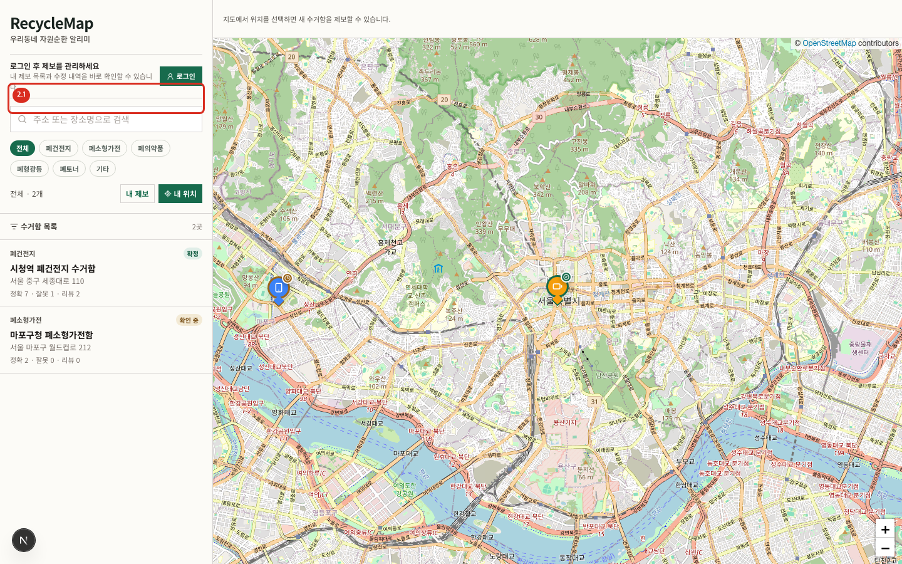
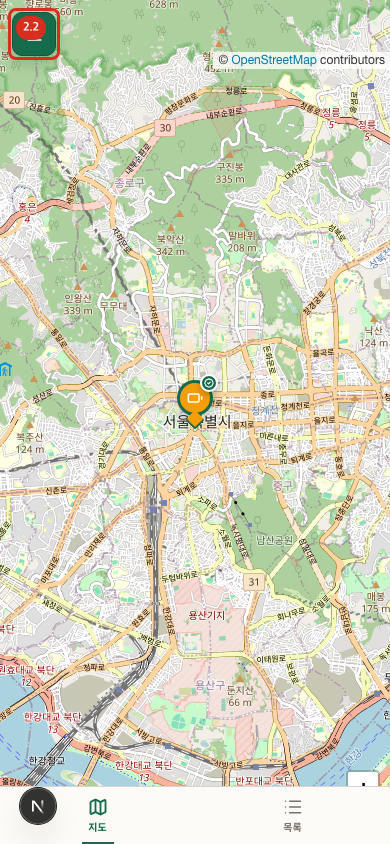
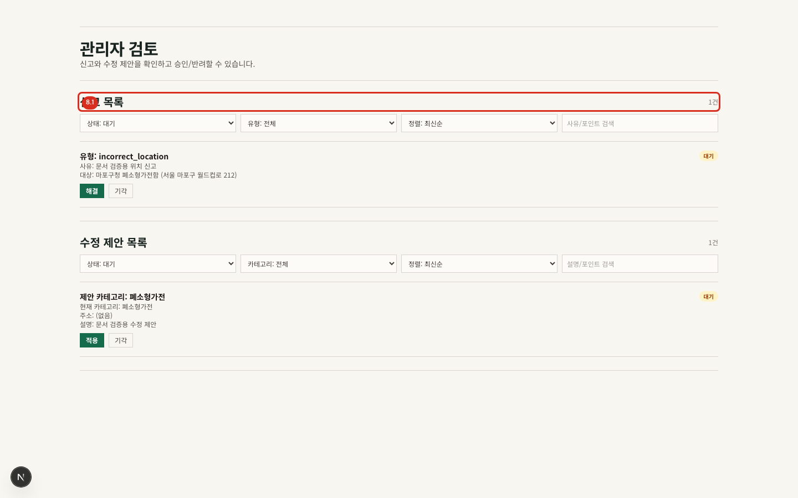

<div align="center">
  <h1>RecycleMap</h1>
  <p><strong>우리동네 자원순환 알리미</strong></p>
  <p>수거함을 찾고, 시민 제보와 검증 투표로 위치 정보의 신뢰도를 함께 관리하는 지도 서비스</p>
</div>

<p align="center">
  <a href="https://github.com/JakeKang/recycle-map/actions/workflows/release-gate.yml">
    
  </a>
  
  
  
</p>

## 화면

| 데스크톱 지도 | 모바일 지도 | 위치 검증 | 관리자 검토 |
|:---:|:---:|:---:|:---:|
|  |  |  |  |

## v1.0 핵심 기능

| 기능 | 설명 |
| --- | --- |
| 지도 탐색 | Leaflet 지도, 검색·분류, 지도 범위 목록, URL 딥링크와 뒤로가기 복원 |
| 위치 제보 | 지도 좌표 선택, Daum 주소 검색, 현장 사진, 50m 동일 분류 중복 방지, 일일 5건 제한 |
| 시민 검증 | 로그인 사용자별 위치당 한 표, 작성자 자기 투표 차단, 선택 변경 지원 |
| 신뢰 판정 | 정확 5표 이상·찬성률 70% 이상이면 `확정`, 잘못 3표 이상이면 `정확하지 않음`, 그 외 `확인 중` |
| 정보 관리 | 리뷰, 문제 신고, 정보 수정 제안, 작성자 제보 편집과 편집 후 검증 초기화 |
| 관리자 운영 | 검증 상태 수동 조정, 신고 해결·기각, 수정 제안 적용·기각, 대기 건수 표시 |
| 반응형 UI | 데스크톱 탐색 레일·지도·검증 원장, 모바일 지도·메뉴·단계형 상세 시트 |
| 인증·계정 | NextAuth 테스트 계정과 선택적 Google·Kakao·Naver 로그인, 회원정보와 역할별 이동 |

전체 사용법과 장애 복구는 [사용자 매뉴얼](./docs/manual/README.md), 런타임 경계는 [시스템 구조](./docs/architecture.md)를 참고하세요.

## 빠른 시작

```bash
git clone https://github.com/JakeKang/recycle-map.git
cd recycle-map
pnpm install

# 아래 표를 참고해 .env.development를 준비합니다.
pnpm dev
```

로컬 앱은 기본적으로 `http://localhost:3000`에서 실행됩니다.

## 환경 변수

### 공통·운영 필수

| 변수 | 설명 |
| --- | --- |
| `NEXTAUTH_URL` | 서비스 URL. 운영에서는 HTTPS 필수 |
| `NEXTAUTH_SECRET` | NextAuth 서명 비밀키. 운영에서는 32자 이상 |
| `NEXT_PUBLIC_SUPABASE_URL` | Supabase 프로젝트 URL |
| `NEXT_PUBLIC_SUPABASE_ANON_KEY` | Supabase 공개 키 |
| `SUPABASE_SERVICE_ROLE_KEY` | 서버 전용 DB 접근 키. 운영 필수, 클라이언트 노출 금지 |
| `ADMIN_USER_IDS` | `google:계정ID`처럼 provider namespace가 포함된 관리자 ID의 쉼표 구분 목록 |
| `DATA_ENCRYPTION_KEYS` | `v1:base64key` 형식의 AES-256-GCM 키 링. 첫 키가 쓰기용 활성 키 |
| `UPLOAD_STORAGE_MODE` / `NEXT_PUBLIC_UPLOAD_STORAGE_MODE` | 운영에서는 모두 `supabase` |
| `TRUST_PROXY` | 신뢰 프록시가 전달 헤더를 정규화할 때만 `true` |

### 선택 설정

| 변수 | 설명 |
| --- | --- |
| `GOOGLE_CLIENT_ID` / `GOOGLE_CLIENT_SECRET` | Google OAuth |
| `KAKAO_CLIENT_ID` / `KAKAO_CLIENT_SECRET` | Kakao OAuth |
| `NAVER_CLIENT_ID` / `NAVER_CLIENT_SECRET` | Naver OAuth |
| `ENABLE_TEST_ACCOUNTS` / `TEST_ACCOUNT_PASSWORD` | 개발 전용 테스트 로그인. 운영에서는 코드 수준에서 비활성화 |
| `NEXT_PUBLIC_MAP_TILE_URL` | Leaflet 타일 URL 템플릿 |
| `NEXT_PUBLIC_MAP_TILE_ATTRIBUTION` | 타일 저작권 표시 |
| `LOCAL_STORAGE_ROOT_DIR` | 로컬 사진 저장 루트. 기본값은 프로젝트 `data` 폴더 |
| `FORCE_LOCAL_STORE` | `true`이면 Supabase 대신 메모리 저장소 사용. 개발·테스트 전용 |
| `ALLOW_DB_FALLBACK_ON_ERROR` | DB 오류 시 메모리 폴백. 운영에서는 반드시 `false` |
| `ALLOW_DEV_USER_HEADER` / `DEV_USER_HEADER_SECRET` | 비운영 개발 인증 헤더 |
| `NEXT_PUBLIC_DEV_USER_ID` | 개발 UI와 API 요청에 사용할 개발 사용자 ID |

프로덕션에서는 `ALLOW_DEV_USER_HEADER=false`, `ALLOW_DB_FALLBACK_ON_ERROR=false`, `FORCE_LOCAL_STORE=false`, `ENABLE_TEST_ACCOUNTS=false`를 유지합니다. `.env.example`은 이름만 참고하고 비밀값은 배포 플랫폼의 secret store에 보관합니다.

`DATA_ENCRYPTION_KEYS`는 쉼표로 여러 버전을 지정할 수 있습니다. 회전 시 `v2:새키,v1:기존키`처럼 새 키를 맨 앞에 두면 신규 신고 사유·수정 제안·보안 감사 상세는 새 키로 암호화되고 기존 ciphertext는 이전 키로 계속 읽힙니다. 이전 키는 해당 버전의 데이터가 남아 있는 동안 제거하지 않습니다.

OAuth ID namespace 도입 이전 데이터가 있으면 provider를 raw ID만으로 안전하게 추론할 수 없습니다. 운영자는 백업과 기존 인증 로그로 소유자를 확인한 뒤 `legacy_user_identity_mappings(legacy_id, provider, namespaced_id, approved_by)`에 승인 매핑을 먼저 넣어야 합니다. 승인된 사용자만 첫 로그인 시 service-role 전용 DB 함수가 기존 프로필과 소유 데이터를 한 트랜잭션에서 옮깁니다. 매핑이 없거나 기존 ID와 새 ID가 동시에 존재하거나 unique 충돌이 있으면 데이터를 임의 병합하지 않고 로그인을 중단합니다. `ADMIN_USER_IDS`도 배포 전에 새 namespace 형식으로 갱신합니다.

키 도입·회전 후 `pnpm security:reencrypt`로 변경 대상 수를 dry-run 확인하고, 백업 후 `pnpm security:reencrypt -- --apply`로 기존 평문/구버전 ciphertext를 활성 키로 재암호화합니다. 이어서 `pnpm security:verify-encryption`이 성공하는지 확인한 뒤에만 배포를 완료하거나 구버전 키를 제거합니다. 신고 사유·수정 제안·감사 상세뿐 아니라 원본 사진 파일명도 같은 절차의 대상입니다.

실패·중단된 signed upload 객체는 private 상태로 만료되며, 운영 scheduler에서 `pnpm security:cleanup-uploads`를 하루 한 번 실행해 만료된 `pending`/`rejected` 객체와 메타데이터를 제거합니다.

## 데이터베이스 적용

`supabase/migrations`의 SQL을 시간순으로 적용합니다. 운영 보안에는 `20260901090000_security_hardening.sql`까지 모두 필요합니다. 이 migration은 브라우저 DB 역할 권한을 회수하고 service-role API 경계, 신규 중복 차단 trigger, 요청 제한, private 사진 bucket을 구성합니다. 과거 중복 신고는 삭제하지 않으며, 기존 `type=other` 중 엄격한 수정 제안 JSON 형태만 제안 테이블로 옮깁니다. 배포 전 백업을 확보한 뒤 다음 명령으로 개발·운영 환경과 구성을 검사합니다.

```bash
pnpm predeploy:check:full
```

운영 전환은 `DB 백업 → migration 적용 → legacy OAuth 매핑 승인 → 재암호화 --apply → 암호화 verify → 애플리케이션 배포` 순서를 지킵니다. 승인 매핑은 provider를 확인한 사용자만 다음 형태로 등록합니다.

```sql
insert into public.legacy_user_identity_mappings (
  legacy_id,
  provider,
  namespaced_id,
  approved_by
)
values ('<legacy-id>', 'google', 'google:<legacy-id>', '<operator-id>');
```

## 개발과 품질 검사

```bash
pnpm lint             # ESLint
pnpm test             # Vitest 단위·통합 테스트
pnpm test:e2e         # Playwright 사용자 흐름
pnpm test:db-security # 임시 PostGIS DB에 migration/RLS 권한 검증
pnpm build            # 프로덕션 빌드
pnpm security:audit   # 운영 의존성 보안 감사
pnpm perf:smoke       # 반복 가능한 로컬 대량 데이터 성능 스모크
pnpm smoke:full       # 스모크 + E2E + lint + build
```

CI는 pull request와 `main` 푸시에서 secret scan, 실제 PostGIS migration/RLS 검증, 테스트, build, 의존성 audit를 포함한 릴리스 게이트를 실행합니다.

## 보안 경계

- 브라우저의 Supabase anon 역할은 애플리케이션 테이블에 직접 접근하지 못합니다. 모든 데이터 요청은 NextAuth 세션을 검사하는 API를 통과합니다.
- 서버는 환경과 관계없이 `SUPABASE_SERVICE_ROLE_KEY`로만 내부 테이블에 접근하며 anon 키로 폴백하지 않습니다. 로컬 메모리 모드는 `FORCE_LOCAL_STORE=true`로 명시합니다.
- 신고 사유, 수정 제안 payload, 보안 감사 상세, 원본 사진 파일명은 버전형 AES-256-GCM으로 인증 암호화됩니다. 공개 지도 좌표·주소는 서비스 공개 데이터이므로 필드 암호화 대상이 아닙니다.
- 원본 이미지는 파일당 50MB, 한 번에 150MB까지 선택할 수 있습니다. 브라우저가 긴 변 3840px·10MB 이하 WebP로 재인코딩해 EXIF/GPS를 제거한 뒤 private storage에 직접 업로드합니다.
- 완료 API가 객체 크기, MIME, 매직바이트, 해상도, 메타데이터, SHA-256을 재검증하며 작성자가 소유한 준비 완료 사진만 위치에 연결할 수 있습니다.

## 기술 스택

Next.js 16 App Router, React 19, TypeScript 5, Leaflet, TanStack Query, Zustand, NextAuth, Supabase PostgreSQL, Tailwind CSS, Zod, Vitest, Playwright를 사용합니다.

## 문서

- [문서 인덱스](./docs/README.md)
- [시스템 구조](./docs/architecture.md)
- [사용자 매뉴얼](./docs/manual/README.md)
- [QA 및 장애 복구](./docs/manual/09-qa-and-recovery.md)
- [화면 커버리지](./docs/manual/coverage-matrix.md)

## 향후 검토

- 공공 API 연계를 통한 초기 데이터 확장 가능성 검토
- 운영 규모에 맞춘 사진 저장소와 관측성 인프라 확장

버그 리포트와 기능 제안은 [GitHub Issues](https://github.com/JakeKang/recycle-map/issues)에 등록합니다.

## 라이선스

MIT
