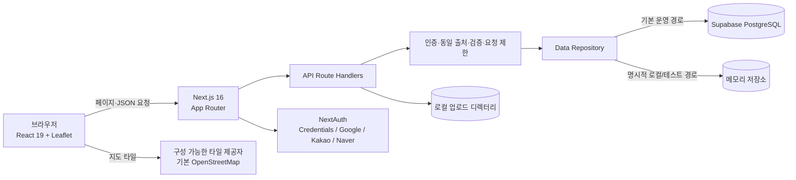
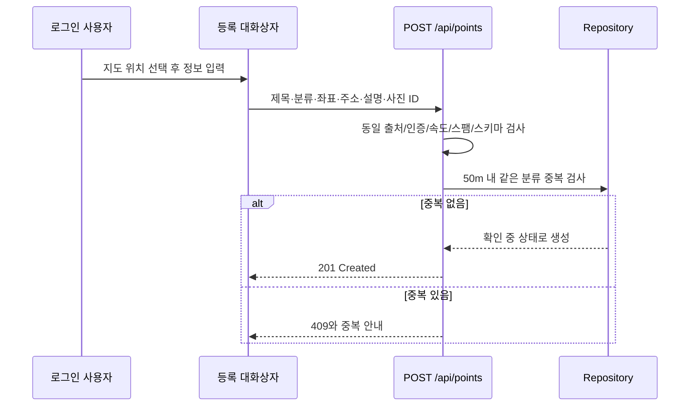
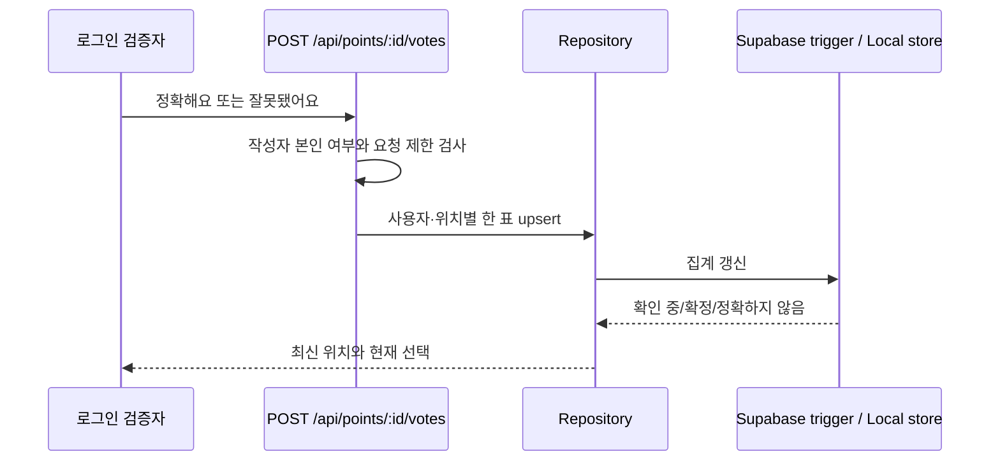

# 시스템 구조

## 목적과 범위

RecycleMap은 대한민국 내 재활용 수거함을 찾고, 시민이 위치를 제보하고, 다른 사용자의 투표로 정보 신뢰도를 판정하는 Next.js 애플리케이션입니다. 이 문서는 v1.0 코드에 존재하는 경계만 설명합니다.

## 런타임 구성

브라우저는 TanStack Query로 서버 데이터를 가져오고 Zustand로 지도·모바일 작업면 상태를 관리합니다. 지도 목록과 상세는 `/api/points` 계열 Route Handler를 사용합니다. `data-repository.ts`가 Supabase 행과 앱 도메인 타입 사이를 변환하며, `FORCE_LOCAL_STORE=true`일 때 반복 가능한 로컬 메모리 데이터를 사용합니다.

## 주요 요청 흐름

### 위치 등록

등록은 사용자별 하루 5건으로 제한됩니다. 새 위치는 `확인 중`이며 정확 투표 0표, 잘못 투표 0표로 시작합니다.

### 시민 검증

한 사용자는 위치마다 한 표를 가지며 선택을 바꿀 수 있습니다. 작성자는 자기 위치에 투표할 수 없습니다. `잘못됐어요` 3표가 먼저 충족되면 `정확하지 않음`, 그렇지 않고 `정확해요` 5표 이상이면서 전체 찬성률 70% 이상이면 `확정`, 나머지는 `확인 중`입니다. 관리자 수동 조정값이 있으면 자동 판정보다 우선합니다. 작성자가 위치 정보를 수정하면 기존 투표와 검증 상태는 초기화되어 변경된 정보를 다시 검증합니다.

## 인증과 권한

- 운영 요청은 NextAuth 세션의 사용자 ID를 사용합니다.
- Google, Kakao, Naver는 각 클라이언트 환경 변수가 모두 있을 때만 로그인 선택지에 나타납니다.
- 테스트 계정은 개발 환경에서 기본 활성화되며, 운영에서는 `ENABLE_TEST_ACCOUNTS=true`일 때만 활성화됩니다.
- `ALLOW_DEV_USER_HEADER=true`인 비운영 환경에서만 개발 사용자 헤더를 허용합니다. `DEV_USER_HEADER_SECRET`을 설정하면 헤더 비밀값도 일치해야 합니다.
- 관리자 ID는 `ADMIN_USER_IDS` 쉼표 목록으로 지정합니다. 미설정 시 코드의 개발 기본값만 사용합니다.
- 위치 수정은 작성자만, 검증 상태 수동 조정과 신고·수정 제안 처리는 관리자만 가능합니다.

## 데이터와 파일 저장

- Supabase 마이그레이션은 `supabase/migrations`의 시간순 SQL 파일로 관리합니다.
- 운영 서버 데이터 접근에는 `SUPABASE_SERVICE_ROLE_KEY`가 필요합니다. 이 값은 서버 전용이며 클라이언트 번들에 노출하면 안 됩니다.
- 로컬 업로드는 기본적으로 `data/uploads`와 `data/upload-meta`에 저장됩니다. `LOCAL_STORAGE_ROOT_DIR`로 루트를 바꿀 수 있습니다.
- 업로드는 JPEG, PNG, WebP만 허용하며 최대 5MB입니다. 확장자가 아니라 파일 매직 바이트도 검사합니다.
- `ALLOW_DB_FALLBACK_ON_ERROR=true`는 저장소 오류를 메모리 데이터로 대체하므로 운영에서는 반드시 `false`여야 합니다.

## 운영 필수 환경 변수

| 변수 | 용도 |
| --- | --- |
| `NEXTAUTH_URL` | 공개 서비스 URL, 운영은 HTTPS |
| `NEXTAUTH_SECRET` | NextAuth 서명 비밀키, 운영은 32자 이상 |
| `NEXT_PUBLIC_SUPABASE_URL` | Supabase 프로젝트 URL |
| `NEXT_PUBLIC_SUPABASE_ANON_KEY` | Supabase 공개 키 |
| `SUPABASE_SERVICE_ROLE_KEY` | 서버 전용 DB 접근 키 |
| `ADMIN_USER_IDS` | 관리자 사용자 ID 목록 |
| `NEXT_PUBLIC_MAP_TILE_URL` | 선택적 Leaflet 타일 URL 템플릿 |
| `NEXT_PUBLIC_MAP_TILE_ATTRIBUTION` | 선택적 타일 저작권 표시 |

소셜 로그인, 개발 인증, 로컬 저장소, 성능 스모크용 선택 변수는 프로젝트 README를 참고합니다.
