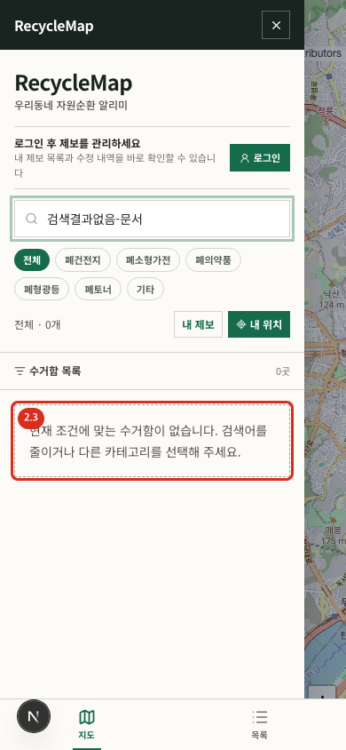

# 02. 지도 탐색과 검색

## 홈 화면 열기

- 경로: `/`
- 사전 조건: 없음
- 결과: 현재 지도 범위의 수거함이 지도 마커와 목록에 함께 표시됩니다.

### 검색과 분류

1. 왼쪽 `주소 또는 장소명으로 검색`에 키워드를 입력합니다.
2. 아래에서 `전체`, `폐건전지`, `폐소형가전`, `폐의약품`, `폐형광등`, `폐토너`, `기타` 중 하나를 선택합니다.
3. 목록과 지도 마커가 같은 조건으로 갱신되는지 확인합니다.
4. 목록 행을 누르면 지도 위치가 선택되고 오른쪽 상세 원장이 열립니다.

검색어와 분류는 URL의 `q`, `category`에 반영되어 새로고침하거나 링크를 공유해도 복원됩니다. 조건에 맞는 항목이 없으면 아래처럼 빈 결과 안내가 나타납니다.

### 지도 조작

- 드래그로 이동하고 `+`, `-`로 확대·축소합니다.
- 마커의 색과 검증 배지는 위치 분류와 검증 상태를 함께 전달합니다.
- `내 위치`를 누르면 브라우저에 위치 권한을 요청하고 허용 시 현재 좌표로 이동합니다.
- 위치 권한을 거절하면 현재 지도는 유지됩니다. 브라우저 사이트 설정에서 위치 권한을 허용한 뒤 다시 누릅니다.

> 브라우저의 위치 권한창은 운영체제·브라우저가 소유하는 화면이라 캡처 대상에서 제외했습니다.

## 모바일

1. 상단 메뉴 버튼으로 검색·분류 패널을 엽니다.
2. 하단 `지도`와 `목록` 탭으로 작업면을 전환합니다.
3. 관리자는 `검토`, `신고` 탭과 대기 건수 배지도 볼 수 있습니다.
4. 마커를 누르면 상세 시트가 열립니다. 시트 손잡이를 위로 끌어 전체 내용을 봅니다.

## 오류와 복구

- 목록 조회 오류: 탐색 레일 또는 모바일 목록의 오류 메시지와 `다시 시도`를 확인합니다.
- 타일이 보이지 않음: 수거함 목록과 상세는 계속 사용할 수 있습니다. 네트워크와 타일 URL·저작권 설정을 확인한 뒤 새로고침합니다.
- 검색이 예상과 다름: 분류를 `전체`로 되돌리고 검색어의 띄어쓰기를 단순화합니다.
