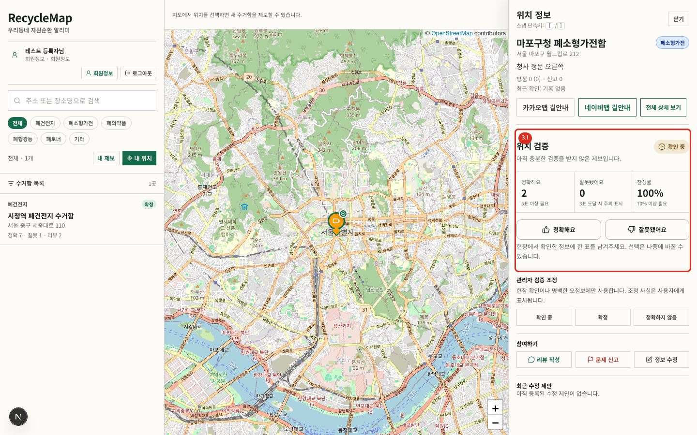
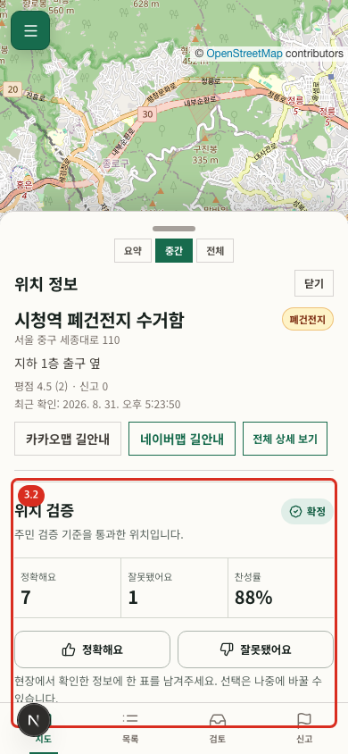
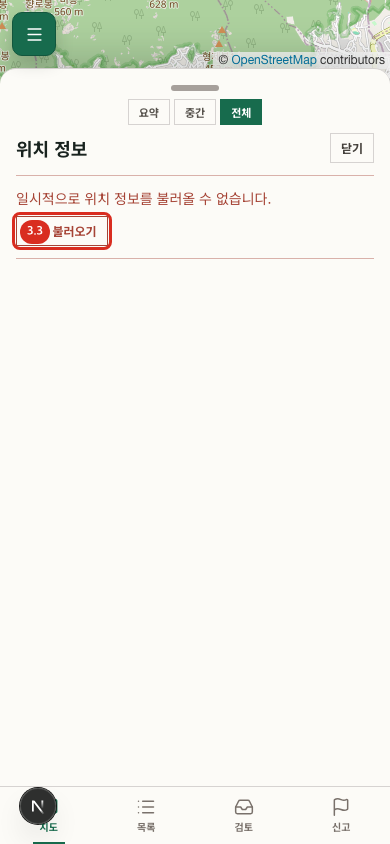

# 03. 위치 상세와 시민 검증

## 상세 열기

- 경로: 홈에서 마커·목록 선택 또는 `/point/:id`
- 사전 조건: 열람은 없음, 투표는 로그인 필요
- 결과: 분류, 주소, 설명, 평점, 신고 수, 최근 확인 시각, 검증 집계, 리뷰를 확인합니다.

## 신뢰 상태 읽기

검증 영역에는 현재 상태와 `정확해요`, `잘못됐어요`, 찬성률이 표시됩니다.

- `확인 중`: 어느 자동 기준에도 도달하지 않음
- `확정`: 정확 5표 이상이면서 찬성률 70% 이상
- `정확하지 않음`: 잘못 3표 이상

잘못 3표 기준을 먼저 적용하므로, 잘못 의견이 기준에 도달한 위치는 정확 표가 많더라도 `정확하지 않음`으로 안내합니다. 관리자 수동 조정 시에는 자동 집계 대신 조정 상태가 적용되고 그 사실이 함께 표시됩니다.

## 투표하기

1. 로그인 후 자신이 작성하지 않은 위치를 엽니다.
2. 현장에서 위치와 분류를 확인합니다.
3. `정확해요` 또는 `잘못됐어요`를 누릅니다.
4. 성공 안내와 갱신된 숫자, 선택 상태를 확인합니다.

사용자마다 위치별 한 표만 저장됩니다. 다른 선택을 누르면 기존 표가 새 선택으로 바뀝니다. 작성자 본인에게는 투표 대신 본인 제보라 투표할 수 없다는 안내가 보입니다.

## 관리자 조정

관리자에게만 `확인 중`, `확정`, `정확하지 않음` 조정 버튼이 보입니다. 이 기능은 현장 확인이나 운영 근거가 있을 때만 사용합니다. 자동 집계로 되돌리려면 `확인 중`으로 조정한 뒤 정책에 따라 다시 검증합니다.

## 상세 조회 오류

1. 오류 문구를 확인합니다.
2. 네트워크 연결을 확인하고 `다시 시도`를 누릅니다.
3. 반복되면 상세를 닫고 목록을 새로고침합니다.
4. 특정 위치에서만 반복되면 위치 링크와 발생 시각을 운영자에게 전달합니다.

## 검증 초기화 주의

작성자가 제보의 제목, 분류, 주소 또는 설명을 수정하면 변경 전 정보에 대한 투표는 더 이상 유효하지 않으므로 집계와 검증 상태가 초기화됩니다. 수정 후에는 `확인 중`부터 다시 검증합니다.
