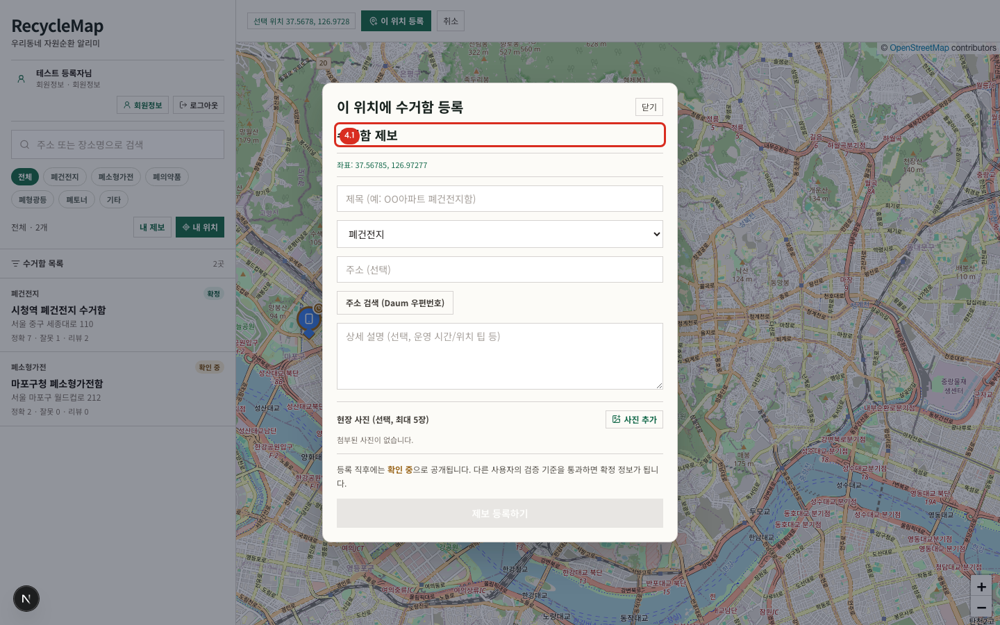
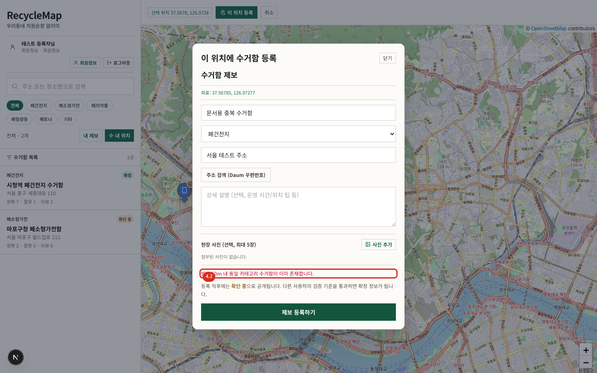

# 04. 위치 등록

## 사전 조건

- 로그인 상태
- 대한민국 범위의 지도 좌표
- 하루 등록 한도 5건 이내
- 같은 분류의 기존 수거함과 50m 이상 떨어진 위치

## 등록 절차

1. 홈에서 `이 위치 등록` 작업을 시작합니다.
2. 지도에서 실제 수거함 위치를 정확히 선택합니다.
3. 제목, 분류를 입력하고 필요하면 주소, 상세 설명, 사진을 추가합니다.
4. `제보 등록하기`를 누릅니다.
5. 등록 성공 후 위치가 `확인 중` 상태로 목록과 지도에 나타나는지 확인합니다.

### 필드 안내

| 필드 | 규칙 |
| --- | --- |
| 제목 | 장소를 식별할 수 있는 구체적인 이름 |
| 분류 | 실제 수거 품목과 일치하는 한 가지 분류 |
| 주소 | 선택 사항. `주소 검색 (Daum 우편번호)`으로 찾거나 확인된 주소 입력 |
| 상세 설명 | 운영 시간, 건물 안 위치, 접근 방법 등 현장 확인에 유용한 정보 |
| 현장 사진 | 선택 사항, JPEG/PNG/WebP 원본 파일당 50MB 이하, 한 번에 합계 150MB 이하, 최대 5장 |

선택한 원본은 브라우저에서 긴 변 3840px·10MB 이하 WebP로 다시 인코딩됩니다. 이 과정에서 EXIF/GPS 같은 원본 메타데이터가 제거되며, 운영에서는 최적화된 파일만 private Storage에 직접 업로드됩니다. 서버 검증을 마쳐 `준비 완료`가 된 사진만 제보 등록 시 한 번 연결할 수 있습니다.

> Daum 우편번호 검색창은 외부 스크립트가 여는 팝업이므로 브라우저 설정에 따라 모양이 달라집니다. 팝업이 차단되면 사이트 팝업을 허용하고 다시 시도합니다.

## 중복 위치

같은 분류의 수거함이 50m 안에 있으면 등록이 중단되고 기존 위치 안내가 표시됩니다. 지도에서 기존 위치를 먼저 열어 정보가 잘못되었는지 확인합니다. 실제로 다른 수거함이라면 지도 좌표와 분류가 맞는지 다시 확인한 후 등록합니다.

## 기타 실패와 복구

- `로그인이 필요한 기능입니다`: 로그인 후 같은 위치에서 다시 시작합니다.
- `일일 등록 한도(5건)를 초과했습니다`: 다음 날 등록하거나 운영자에게 대량 데이터 반영 절차를 문의합니다.
- `스팸성 내용이 감지되었습니다`: 광고성 표현과 반복 문자를 제거합니다.
- `요청이 너무 많습니다`: 잠시 기다린 뒤 한 번만 다시 제출합니다.
- 사진 선택 오류: 원본 파일당 50MB, 선택 합계 150MB, 최대 5장인지 확인합니다.
- 사진 최적화 오류: 해상도가 지나치게 크거나 10MB 이하로 변환할 수 없는 파일입니다. 사진 크기를 줄이거나 다시 촬영해 선택합니다.
- 업로드·검증 오류: 네트워크와 Storage 설정을 확인한 뒤 해당 사진만 다시 선택합니다. 실패한 파일은 위치에 공개 연결되지 않으며 운영 정리 작업이 만료 객체를 제거합니다.

제출 버튼을 여러 번 누르지 않습니다. 오류가 난 경우 화면 메시지를 먼저 확인해 실제 등록 여부를 판단합니다.
