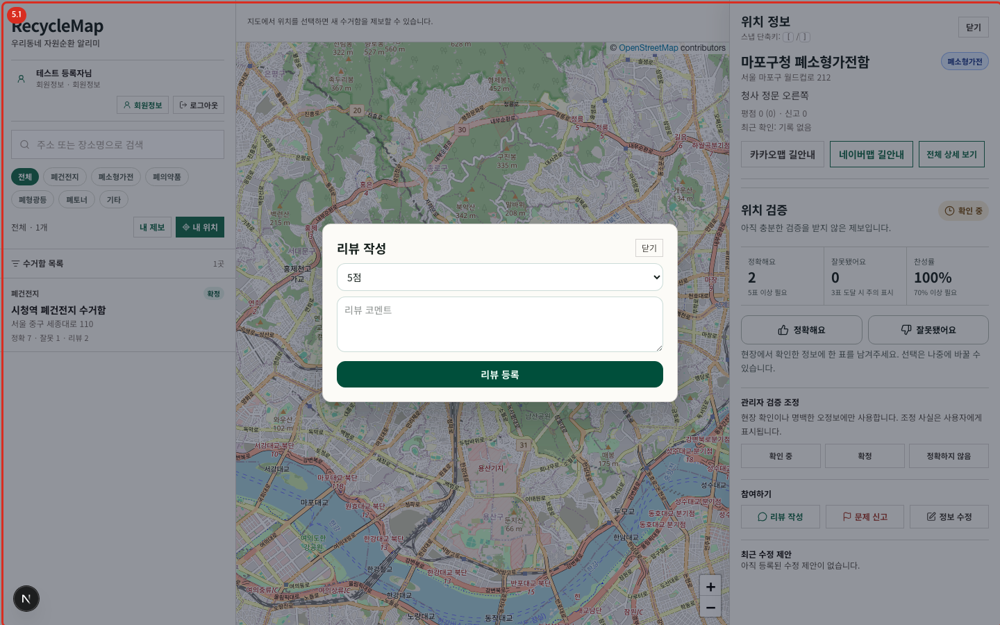
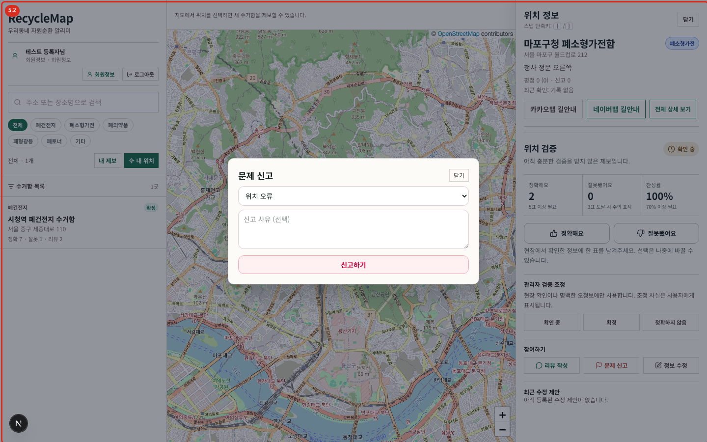
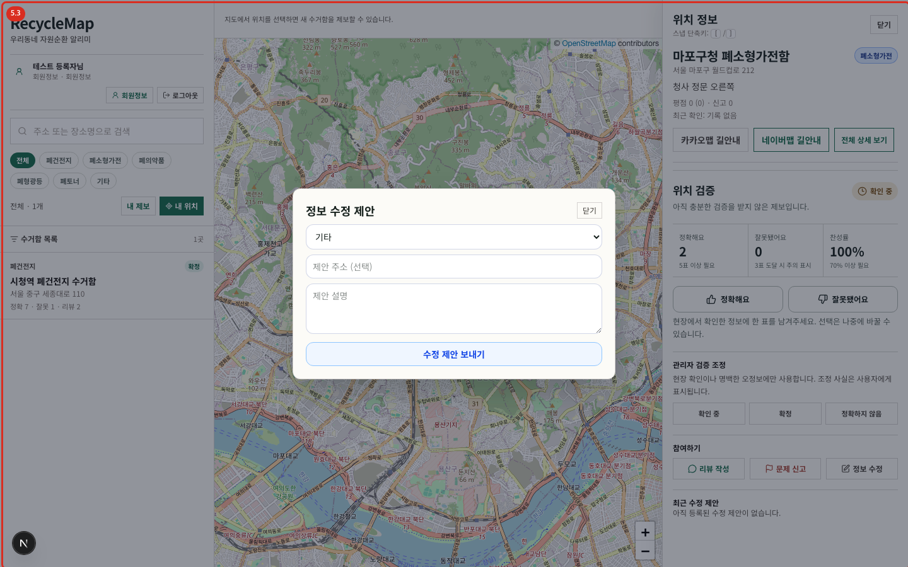

# 05. 리뷰·문제 신고·정보 수정 제안

세 기능은 모두 로그인해야 사용할 수 있으며, 목적이 서로 다릅니다.

| 기능 | 사용 시점 | 처리 결과 |
| --- | --- | --- |
| 리뷰 작성 | 이용 경험과 현장 상태를 공유 | 상세의 평점·리뷰 목록 갱신 |
| 문제 신고 | 위치 오류, 철거, 분류 오류, 스팸 등 운영 검토가 필요 | 관리자 신고 목록에 대기 건 생성 |
| 정보 수정 제안 | 분류·주소·설명의 구체적 수정안을 제시 | 관리자 제안 목록에 대기 건 생성 |

## 리뷰 작성

1. 위치 상세의 `리뷰 작성`을 누릅니다.
2. 1~5점 평점을 고르고 필요한 코멘트를 입력합니다.
3. `리뷰 등록`을 누릅니다.
4. 성공 안내와 평점·리뷰 수 갱신을 확인합니다.

오류가 표시되면 내용을 유지한 채 네트워크를 확인하고 다시 제출합니다. 같은 내용의 중복 리뷰가 생기지 않도록 성공 안내를 먼저 확인합니다.

## 문제 신고

1. `문제 신고`를 누릅니다.
2. 위치 오류, 더 이상 존재하지 않음, 분류 오류, 스팸, 부적절, 기타 중 유형을 선택합니다.
3. 운영자가 재현할 수 있도록 이유를 입력합니다.
4. `신고하기`를 눌러 접수 안내를 확인합니다.

신고는 위치의 `정확해요/잘못됐어요` 투표와 별도입니다. 현장 정보가 잘못되었다면 `잘못됐어요` 투표와 문제 신고를 함께 사용할 수 있습니다.

## 정보 수정 제안

1. `정보 수정`을 누릅니다.
2. 바꿀 분류와 선택적 주소·설명을 입력합니다.
3. `수정 제안 보내기`를 누릅니다.
4. 성공 안내와 상세 하단의 최근 제안 상태를 확인합니다.

제안은 즉시 원본을 바꾸지 않습니다. 관리자가 `적용`해야 위치 정보에 반영됩니다. 작성자 본인이 즉시 고쳐야 하는 경우에는 [내 제보 관리](./06-my-reports.md)의 `편집`을 사용합니다.

## 닫기와 뒤로가기

각 대화상자의 `닫기`를 누르면 입력을 끝내고 상세로 돌아갑니다. 모바일에서 브라우저 뒤로가기를 사용하면 대화상자 또는 상세 시트의 직전 URL 상태로 돌아갑니다. 제출 중에는 버튼이 비활성화되므로 완료 메시지를 기다립니다.
