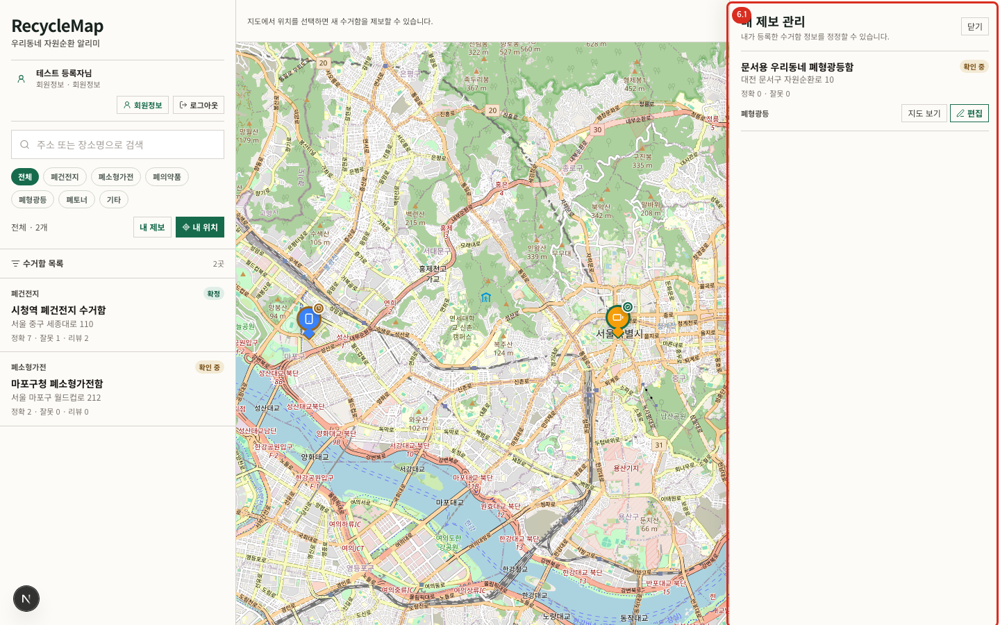
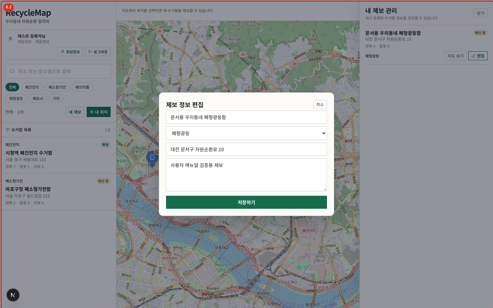

# 06. 내 제보 관리

## 열기

- 경로: 홈의 `내 제보` 또는 `/?reports=1`
- 사전 조건: 로그인
- 결과: 로그인 사용자가 직접 등록한 위치만 표시됩니다.

각 행에서 제목, 주소, 분류, 검증 상태와 정확·잘못 표 수를 확인합니다. `지도 보기`는 해당 위치를 선택해 상세를 열고, `편집`은 작성자 전용 수정 대화상자를 엽니다.

## 제보 수정

1. 수정할 항목에서 `편집`을 누릅니다.
2. 제목, 분류, 주소, 설명을 고칩니다.
3. `저장하기`를 누릅니다.
4. 목록과 상세에 변경 내용이 반영되었는지 확인합니다.

수정은 원래 작성자만 할 수 있습니다. 정보가 달라지면 기존 검증 표와 상태가 초기화되어 다시 `확인 중`이 됩니다. 이는 변경 전 정보에 대한 표가 변경 후 정보에 잘못 이어지는 것을 막기 위한 동작입니다.

## 오류와 복구

- 로그인 화면으로 이동함: 세션이 만료되었습니다. 로그인 후 `/?reports=1`로 다시 엽니다.
- `수정 권한이 없습니다`: 현재 계정과 제보 작성자가 다릅니다. 올바른 계정으로 전환합니다.
- 목록 또는 저장 오류: 오류 메시지의 `다시 시도`를 사용하거나 시트를 닫고 다시 엽니다.
- 저장 후 상태가 `확인 중`: 정상 동작입니다. 변경된 정보는 시민 검증을 다시 받아야 합니다.
