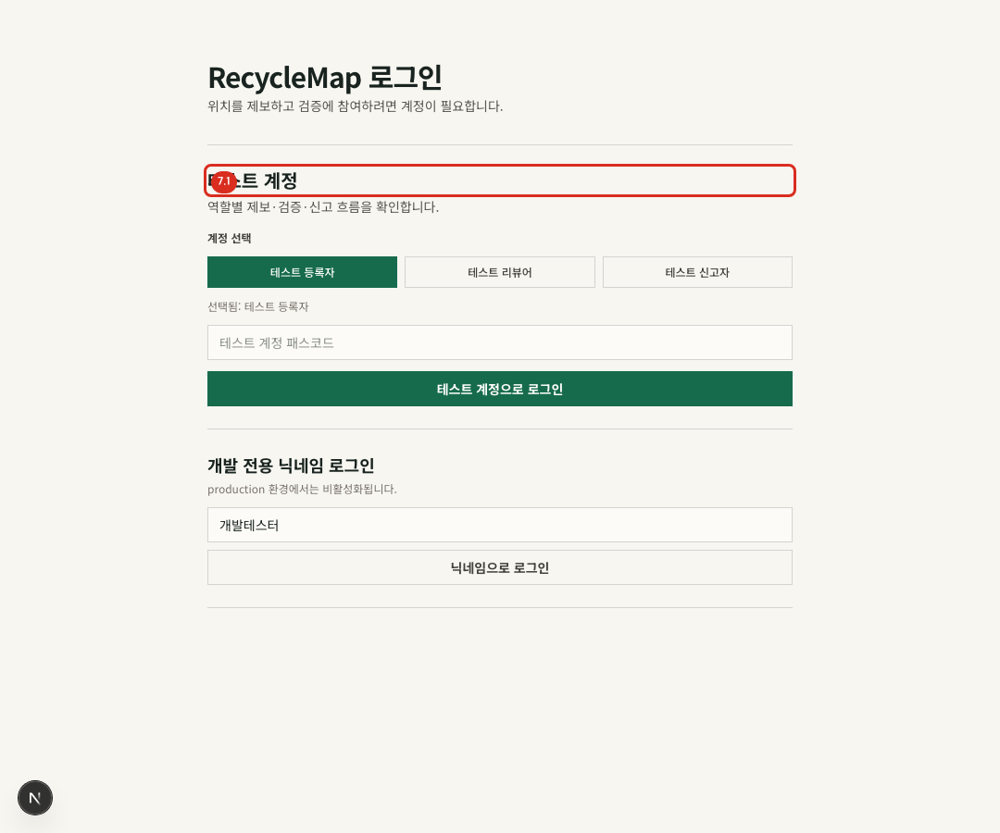
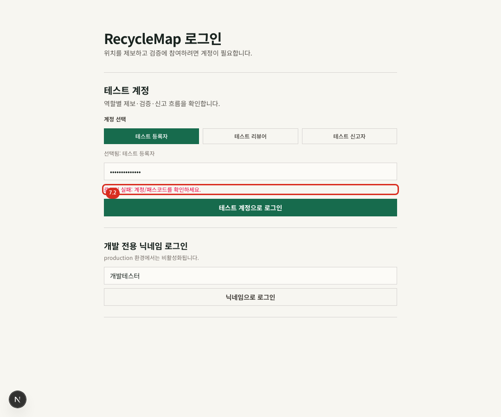
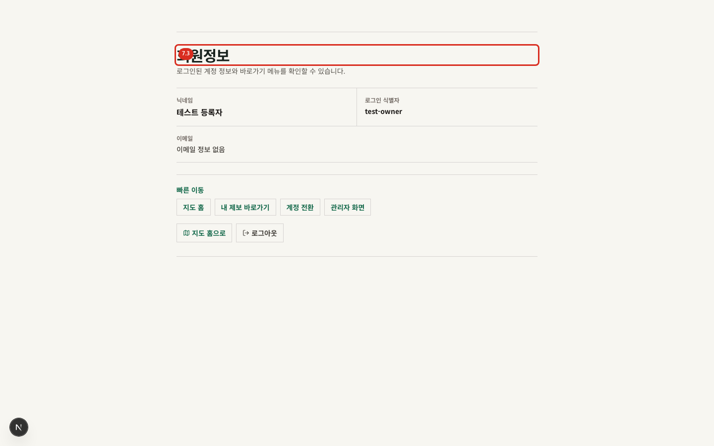

# 07. 로그인과 회원정보

## 로그인

- 경로: `/login`
- 결과: 성공하면 `callbackUrl` 또는 홈으로 이동합니다.

개발 환경에서는 역할별 테스트 계정을 선택하고 설정된 패스코드를 입력할 수 있습니다. 운영에서는 `ENABLE_TEST_ACCOUNTS=true`로 명시한 경우에만 테스트 계정 영역이 동작합니다. Google, Kakao, Naver 버튼은 해당 제공자의 클라이언트 ID와 비밀키가 모두 설정된 경우에만 표시됩니다.

개발 전용 닉네임 로그인은 운영에서 비활성화됩니다.

> 소셜 제공자의 동의·로그인 화면은 외부 서비스가 소유하므로 이 매뉴얼에서는 캡처하지 않습니다. 로그인 실패 시 제공자 화면의 메시지와 서비스 환경 변수, 등록된 callback URL을 함께 확인합니다.

## 로그인 실패

1. 선택한 테스트 계정과 패스코드를 다시 확인합니다.
2. 운영 환경이라면 테스트 계정 기능이 활성화되었는지 운영자에게 확인합니다.
3. 소셜 로그인이라면 제공자 설정과 callback URL을 확인합니다.
4. 실패가 반복되면 브라우저 쿠키를 지우기 전에 다른 브라우저나 비공개 창에서 재현 여부를 확인합니다.

## 회원정보

- 경로: `/account`
- 사전 조건: 로그인. 비로그인 사용자는 로그인 화면으로 이동합니다.

회원정보에서 닉네임, 로그인 식별자, 이메일을 확인합니다. 빠른 이동은 `지도 홈`, `내 제보 바로가기`, `계정 전환`을 제공합니다. 관리자 계정에는 `관리자 화면`도 보입니다. `로그아웃`을 누르면 세션을 종료하고 홈으로 돌아갑니다.

로그인 식별자는 권한 판정에 쓰이는 값이므로 운영 문의 시 필요한 경우에만 전달하고 공개 게시물에는 노출하지 않습니다.
