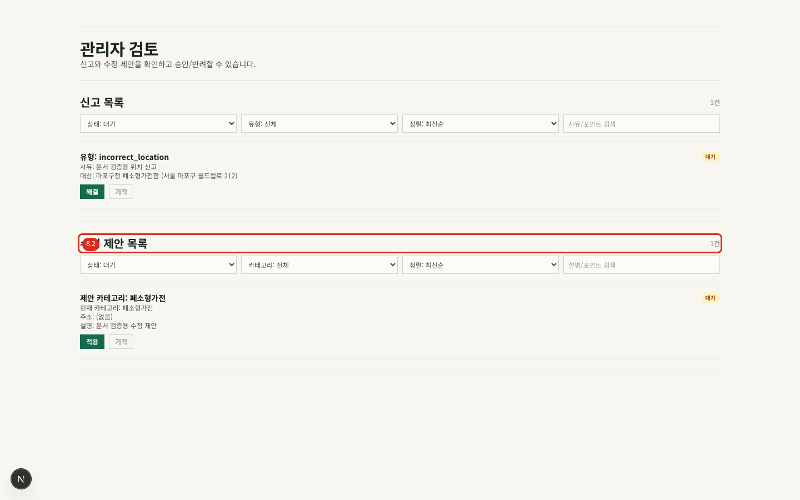

# 08. 관리자 운영

## 접근과 원칙

- 경로: `/admin`
- 사전 조건: `ADMIN_USER_IDS`에 포함된 로그인 계정
- 비관리자 결과: 홈으로 이동

관리자 화면은 시민 투표를 대체하는 일반 편집기가 아닙니다. 신고 처리, 수정 제안 심사, 현장 근거가 있는 검증 상태 조정에만 사용합니다.

## 신고 처리

1. 상태, 유형, 정렬, 검색어로 신고를 좁힙니다.
2. 신고 유형·사유와 대상 위치를 확인합니다.
3. 필요한 경우 지도 상세와 현장 근거를 교차 확인합니다.
4. 조치가 끝났으면 `해결`, 근거가 부족하거나 잘못된 신고면 `기각`을 누릅니다.
5. 행의 상태가 `해결됨` 또는 `기각됨`으로 바뀌는지 확인합니다.

처리 요청이 실패하면 같은 버튼을 연속으로 누르지 말고 오류를 확인한 뒤 목록을 새로고침해 현재 상태를 먼저 확인합니다.

## 수정 제안 처리

1. 상태, 제안 분류, 정렬, 검색어로 목록을 좁힙니다.
2. 현재 분류와 제안 분류, 주소·설명 변경안을 비교합니다.
3. 사실 확인이 끝난 제안은 `적용`, 부정확하거나 불충분한 제안은 `기각`합니다.
4. 적용 후 대상 위치 상세에서 실제 값과 검증 상태를 확인합니다.

제안 적용은 위치 데이터를 변경하므로 변경된 정보가 다시 검증되어야 합니다. 운영 기록에는 가능하면 확인 근거와 처리 시각을 함께 남깁니다.

## 검증 상태 수동 조정

위치 상세의 `관리자 검증 조정`에서 `확인 중`, `확정`, `정확하지 않음`을 선택합니다. 수동 조정 사실은 사용자에게 표시됩니다. 현장 확인 근거가 사라졌거나 자동 집계로 복귀시켜야 할 때는 운영 정책을 확인한 뒤 `확인 중`으로 되돌립니다.

## 교대 점검

1. 대기 신고 수와 대기 제안 수를 확인합니다.
2. 오래된 항목부터 사실관계를 검토합니다.
3. 처리 후 필터를 `대기`로 유지해 남은 건수를 확인합니다.
4. 일반 사용자 화면에서 결과와 상태 문구를 검증합니다.
5. 반복 실패나 데이터 불일치는 발생 시각, 계정 ID, 대상 위치 ID, 요청 유형과 함께 개발 담당자에게 전달합니다.
